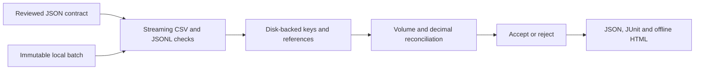

# BatchGate

**Catch broken imports before they reach your application.**

[](https://github.com/ABRJrocks/batchgate/actions/workflows/ci.yml)
[](pyproject.toml)
[](LICENSE)

BatchGate is a local, dependency-free Python quality gate for CSV and JSONL batches. Define a versioned contract, validate related files, and block your CRM import, ETL job, or reporting pipeline when the data breaks it. Run it as a CLI, call the Python API, or use the included GitHub Action.

It checks types and business rules, finds duplicate keys and orphaned references, and reconciles exact decimal totals across files. Reports identify failed rules and row locations while omitting cell values.

```text
PASS customers: rows=2 invalid=0 issues=0 scan=complete
PASS orders: rows=2 invalid=0 issues=0 scan=complete
PASS payments: rows=2 invalid=0 issues=0 scan=complete
PASS order_payment_totals: sum_match
ACCEPTED batch
```

## Use in GitHub Actions

Run this gate before the step that imports your files. Check out your repository and set up Python 3.10+ first:

```yaml
- uses: actions/checkout@11d5960a326750d5838078e36cf38b85af677262
- uses: actions/setup-python@a26af69be951a213d495a4c3e4e4022e16d87065
  with:
    python-version: '3.12'
- uses: ABRJrocks/batchgate@v0.1.1
  with:
    contract: contracts/commerce.json
    data-directory: incoming/current
    report-prefix: reports/import
```

| Input | Required | Purpose |
| --- | --- | --- |
| `contract` | Yes | JSON contract path relative to the workflow workspace |
| `data-directory` | Yes | Directory holding the files declared in the contract |
| `report-prefix` | No | Report path prefix, defaults to `reports/batchgate` |

A rejected batch fails the step and blocks subsequent import steps. A normal validation failure still writes `.json`, `.xml` and `.html` reports. Configuration or I/O failures may produce no report. Use `if: always()` on a separate artifact upload step to preserve reports. The Action uploads nothing itself and needs no service token.

Pin a reviewed commit SHA for reproducible workflows. The Action installs BatchGate into the selected Python environment; installation can contact your configured package index for build tooling. See the [complete workflow and integration recipes](docs/integrations.md) for artifact uploads and operational limits.

## Try a real batch gate

Requires Python 3.10+. There is no PyPI release yet. Install from the repository or use a wheel attached to the [releases](https://github.com/ABRJrocks/batchgate/releases).

```sh
git clone https://github.com/ABRJrocks/batchgate.git
cd batchgate
python -m venv .venv
source .venv/bin/activate
python -m pip install .

batchgate check examples/commerce.contract.json --data-dir examples/good \
  --json-report reports/good.json --junit reports/good.xml \
  --html-report reports/good.html
```

On Windows activate the environment with `.venv\Scripts\Activate.ps1`. Open `reports/good.html` in your browser. It is a self-contained report with no scripts or remote assets.

Run the deliberately broken batch with the same contract:

```sh
batchgate check examples/commerce.contract.json --data-dir examples/bad \
  --json-report reports/bad.json --junit reports/bad.xml \
  --html-report reports/bad.html
```

It returns exit code **1** and identifies duplicate customers, orders and payments, orphaned references, an invalid amount, an invalid timestamp, an unsupported payment status, and shipping before an order date. The report marks reconciliation unavailable because its source datasets failed. All example records are synthetic.

## What teams can integrate

| Workflow | Gate |
| --- | --- |
| CRM or customer imports | Required fields, allowed values, unique identifiers and child-file references |
| ETL and reporting pipelines | Producer schema, record volume, dates, duplicates and cross-file integrity |
| Commerce exports | Order/customer/payment relationships and reviewed decimal total reconciliation |
| Flat JSONL datasets | Scalar contracts, record identifiers, explicit missing/null behavior and bounded diagnostics |



## A small contract

```json
{
  "version": 1,
  "name": "Customer import",
  "datasets": [{
    "name": "customers",
    "path": "customers.csv",
    "format": "csv",
    "fields": {
      "customer_id": {"type": "string", "min_length": 1},
      "plan": {"type": "string", "enum": ["starter", "business"]},
      "credit_limit": {"type": "decimal", "min": "0", "max": "100000"}
    },
    "primary_key": ["customer_id"],
    "row_count": {"min": 1}
  }]
}
```

```sh
batchgate lint contracts/customers.json
batchgate check contracts/customers.json --data-dir incoming/current \
  --junit reports/import.xml && python scripts/import_customers.py incoming/current
```

The second command runs your importer only after acceptance. Keep the batch immutable through the consuming step. The tool never repairs or imports records itself.

## Capabilities

- Strict contracts reject unknown options and invalid relationships before data is read.
- String, integer, decimal, boolean, calendar date and timezone-aware datetime types.
- Required/null rules, numeric bounds, string lengths, full-match patterns and typed enums.
- Primary and composite unique keys with disk-backed, per-run hashed indexes.
- Cross-file, cyclic and self-references checked after all datasets are scanned.
- Field-pair comparisons, inclusive volume bounds and exact whole-column sum comparisons.
- Bounded file/row/line scans and bounded samples with complete issue counts.
- Ordinary file-change detection, protected CLI report destinations and atomic report writes.

Use the [full commerce contract](examples/commerce.contract.json) to see references, date comparisons and reconciliation together.

## Integration and documentation

- [GitHub Actions, shell and Python/ETL recipes](docs/integrations.md)
- [Contract fields, key/null semantics, limits and error codes](docs/contracts.md)
- [Research, existing alternatives and design decisions](docs/research.md)
- [Security and operational boundaries](SECURITY.md)
- [Contribution guide](CONTRIBUTING.md)

Frictionless, Great Expectations and Soda are established alternatives. BatchGate focuses on local file batches with no runtime dependencies or hosted service. Its contract format is independent of Table Schema and JSON Schema.

## Validation and release status

The test suite covers accepted and rejected batches, real CSV/JSONL parsing, composite keys, reference order, decimal precision, incomplete scans, file mutation, report redaction and CLI exit codes. CI tests Linux on Python 3.10/3.12/3.13, macOS and Windows on Python 3.12, an installed wheel, and the composite action's acceptance and rejection paths.

```sh
python -m pip install -e .
python -m unittest discover -s tests -v
```

**Status: 0.1.1 prerelease.** Validate the contract against your own data and consumer before adoption. Equal column totals do not establish per-record correctness. File metadata checks do not create a transaction with your importer. The runner has no built-in hard execution deadline or disk quota; your orchestrator controls those limits.

MIT licensed. Built and maintained by [Abdul Rafay](https://www.rafayai.dev).
